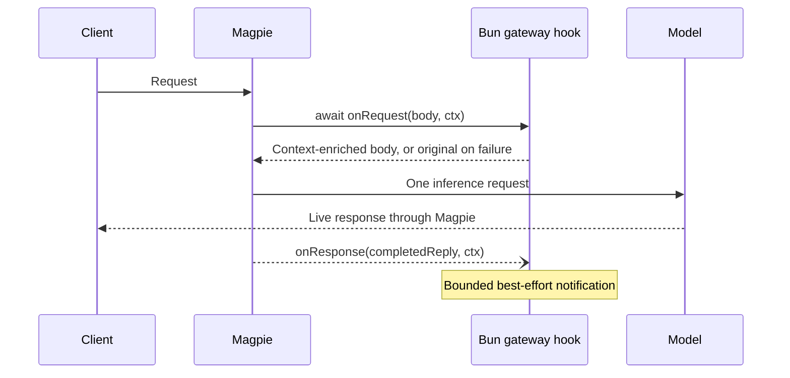

# Asynchronous gateway hooks

Opt-in Bun hooks add external context before routing and observe completed replies.
The gateway makes one model request per client request. Tool declarations, tool
execution and subsequent inference rounds belong to the client.



## Entry and request contract

Declare `"magpie": {"gateway": "./context.gateway.ts"}` in package.json,
or install a `*.gateway.js`, `.mjs`, `.ts` or `.mts` file using `magpie plugin add`.
Bun runs TypeScript directly. A gateway-only package does not need provider
main/exports, a client MCP installation, or a client skill.

`export async function onRequest(body, ctx)` receives the client protocol JSON
before routing. Return a JSON object to add context; return `undefined` to keep
it. Mutations are rolled back when a hook throws, times out, returns invalid data,
or changes client tool declarations or tool choice. It cannot reject requests or
register tools. The synchronous middleware API remains available separately.

Context fields: `protocol` (`chat`, `responses`, `anthropic`, `gemini`), `model`,
`stream`, `path`, `agent`, `session`, `cwd`, `query`, package `options`, private
request `state`, an `AbortSignal` and `report(code, bytes)`. Headers and client
credentials are not forwarded to the hook. Query extraction keeps original model
input intact while excluding client environment/instruction notices from recall.
Empty identity fields must not be interpreted as authenticated user identity.

The `gatewayTimeoutMs` option accepts 100–10000 ms (default 1000 ms). The
entire request hook chain is bounded to ten seconds, with an eleven-second host
startup/RPC limit, including waiting for a host already starting during provider
discovery. The first request waits within that budget rather than skipping its
hook because startup holds the host lock. Client cancellation aborts the wait
and request-hook I/O. Hooks run in
plugin order. Failure keeps the last accepted request; diagnostics contain fixed
outcome codes and byte counts rather than private content.

## Completion notification

`export async function onResponse(reply, ctx)` is optional. It observes the
client-facing reply after response middleware finishes writing it. Streaming
bytes are forwarded immediately; a bounded copy is consolidated into that
protocol's response shape only for this callback. The callback cannot rewrite
client output. `ctx.request` contains the accepted request, `ctx.success` reports
completion, and the same per-hook `ctx.state` links recall with capture.

Notification is fire-and-forget, with a fresh timeout signal independent of the
finished HTTP request. It never waits for an observer's network operation before
returning client EOF. Request failure, cancellation, an incomplete stream or a
capture over 8 MiB prevents successful capture (`success: false`, possibly a null
reply). This is best-effort delivery, not a durable queue: shutdown, host
retirement and capacity limits may discard notifications. Hooks must not blindly
retry non-idempotent external writes.

Host request state is limited to 128 runs and expires after 15 minutes. The
response RPC has an eleven-second limit; each callback uses the configured
bounded hook timeout. Request-owned state is released after notification.

## Sources and verification

- `internal/plugin/gateway.go`: entry discovery, cancellation, completion dispatch.
- `internal/plugin/host.js`: async execution, rollback, state and deadlines.
- `internal/gateway/middleware.go`: before-routing and after-output placement.
- `internal/gateway/gateway_hooks.go`: bounded response observation.
- `internal/gateway/gateway_hook_stream.go`: protocol-specific stream consolidation.
- `internal/plugin/gateway_test.go` and `internal/gateway/gateway_hook_test.go`:
  failures, cancellation, ownership and real HTTP streaming.

Follow [provider plugin verification](provider-plugins.md#verification) to use
isolated HOME and resolved Go/Bun executables. Targeted race acceptance:

```sh
go test -race -tags nogui ./internal/plugin ./internal/gateway -run '^TestGateway|^TestAsyncGateway' -count=1
```

Service deployment, automatic installation and gateway-owned tool loops are
outside this contract. A concrete companion integration is PowerContext recall
via `/v1/context/prepare` and conversation capture via `/v1/sources/content`.
